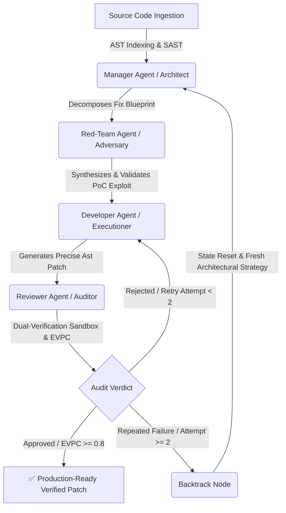

<div align="center">
  
  <h1>✈️ Squadron.AI</h1>
  <p><strong>Autonomous DevSecOps & Multi-Agent Code Remediation Platform</strong></p>

  <p>
    <a href="#-architecture"></a>
    <a href="#-tech-stack"></a>
    <a href="#-benchmarks"></a>
    <a href="#-tests"></a>
    <a href="#-security"></a>
  </p>
</div>

---

## 🚀 Overview

**Squadron.AI** is an advanced, autonomous multi-agent DevSecOps platform. It ingests vulnerable or buggy source code, coordinates a specialized squad of LLM-powered agents to statically analyze, synthesize adversarial Proof-of-Concept (PoC) exploit scripts, generate secure patches, and verify repairs within a hardened execution sandbox—achieving high Execution-Verified Patch Confidence (EVPC).

---

## 🧠 Core Architecture: The Multi-Agent Pipeline

Squadron.AI operates a cyclic, stateful state machine built on **LangGraph**:



### 1️⃣ Manager Agent (The Architect)
Runs strict static pre-scans (`SASTScannerSkill`, `ASTIndexerSkill`) to detect CWE patterns, classify vulnerabilities, and generate a surgical, step-by-step JSON remediation blueprint.

### 2️⃣ Red-Team Agent (The Adversary)
Adversarially synthesizes standalone Proof-of-Concept (PoC) exploit scripts before patching to empirically confirm the baseline vulnerability exists.

### 3️⃣ Developer Agent (The Executioner)
Applies AST-aware code patch blocks and parameterized sanitization with strict anti-hallucination constraints (`temperature=0.1`).

### 4️⃣ Reviewer Agent (The Auditor)
Executes dual verification: verifies PoC neutralization, checks regression tests, calculates unified diff delta LOC, and computes the mathematical **EVPC score**.

---

## 📁 Repository Structure

```
squadron.ai/
├── api.py                    # Unified FastAPI backend & static frontend server
├── static/                   # Production Web UI (HTML, CSS, JS)
├── opensquad/                # Core Python package
│   ├── config.py             # Environment configuration & provider settings
│   ├── graph.py              # LangGraph workflow root export
│   ├── utils.py              # Validation, patch verification, and clean output utilities
│   ├── agents/               # Manager, Red-Team, Developer, and Reviewer agents
│   ├── core/                 # State schema, graph machine, memory, telemetry, LLM provider
│   ├── harness/              # Deterministic AST indexer, diff patcher, SAST & test runner
│   ├── skills/               # Agent skill wrappers (SAST, AST, diff patch, PoC generator)
│   ├── sandbox/              # E2B hardened sandbox executor and container pool
│   └── benchmark/            # EVPC engine, dataset loader, results logger
├── tests/                    # Automated test suites
│   ├── unit/                 # Unit tests (AST indexer, patcher, EVPC, CWE classifier)
│   ├── integration/          # LangGraph backtracking and flow integration tests
│   ├── fixtures/             # Isolated benchmark sample files
│   └── pocs/                 # Ephemeral runtime PoC directory (.gitkeep)
├── benchmarks/               # Empirical evaluation scripts & data
│   ├── eval_security.py      # Hugging Face SecurityEval dataset evaluator
│   ├── eval_synthetic.py     # Multi-case async synthetic benchmark runner
│   ├── generate_plots.py     # Publication-quality figure generation (saved to plots/)
│   └── data/                 # Benchmark caches & evaluation output datasets
├── scripts/                  # Diagnostics & tools
│   └── diagnostics/          # Model routing, individual agent tests, smoke tests
├── pyproject.toml            # PEP 517/621 package & build configuration
├── pytest.ini                # Pytest discovery and warning filters
└── requirements.txt          # Production dependencies
```

---

## ⚙️ Setup & Installation

### 1. Clone & Virtual Environment
```bash
git clone https://github.com/anshurana665/squadron-ai.git
cd squadron-ai

python -m venv venv
# On Windows:
venv\Scripts\activate
# On Linux/macOS:
source venv/bin/activate
```

### 2. Install Dependencies
```bash
pip install -r requirements.txt
# Or install in editable mode with development dependencies:
pip install -e ".[dev,benchmarks]"
```

### 3. Environment Configuration
```bash
cp .env.example .env
```
Populate `.env` with your API credentials (`OPENROUTER_API_KEY`, `GROQ_API_KEY`, or `GOOGLE_API_KEY`).

---

## 🚀 Running the Platform

Launch the unified server (FastAPI API + Web Application):
```bash
uvicorn api:app --port 8000 --reload
```
Open **[http://localhost:8000](http://localhost:8000)** in your browser.

---

## 🧪 Testing & Quality Assurance

Run the complete automated test suite (unit and integration tests):
```bash
pytest
```
All 42 tests run deterministically without external network or API dependencies.

To run individual diagnostic utilities:
```bash
# Check model routing & connectivity
python scripts/diagnostics/check_model_routing.py

# Run pipeline smoke test
python scripts/diagnostics/smoke_test_pipeline.py
```

---

## 📊 Benchmarks & EVPC Evaluation

```bash
# Synthetic benchmark dry-run
python benchmarks/eval_synthetic.py --test-dry-run

# Run SecurityEval evaluation
python benchmarks/eval_security.py 5

# Render publication-quality benchmark plots
python benchmarks/generate_plots.py
```

---

## 🛡️ License
Distributed under the **MIT License**.
